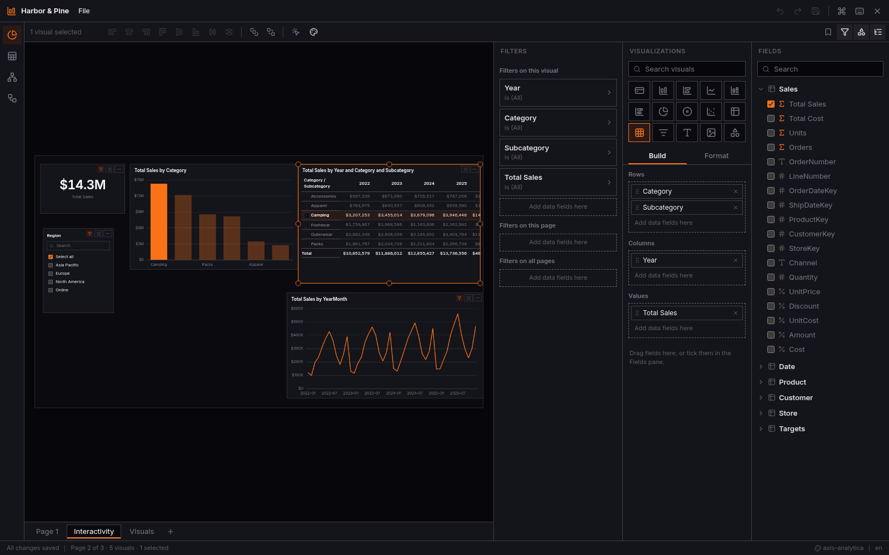
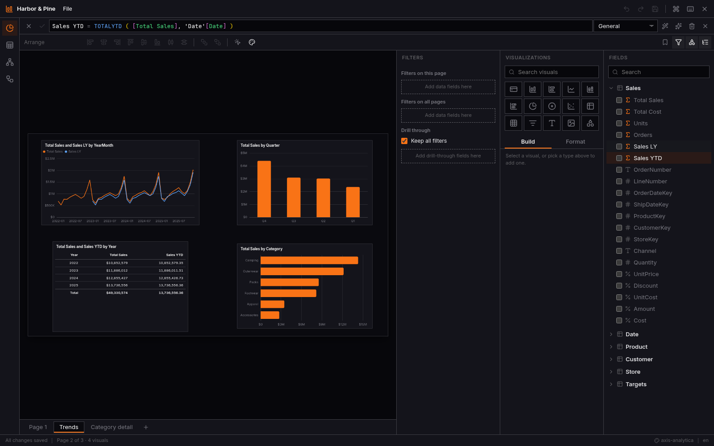
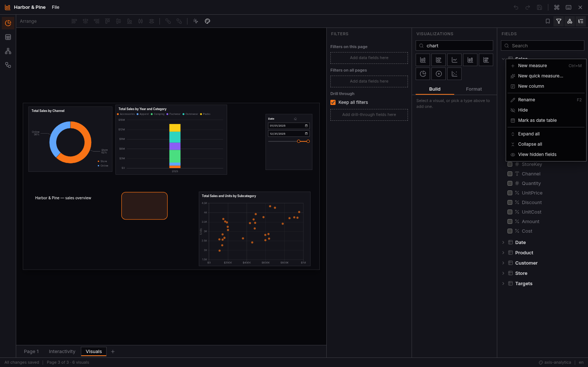
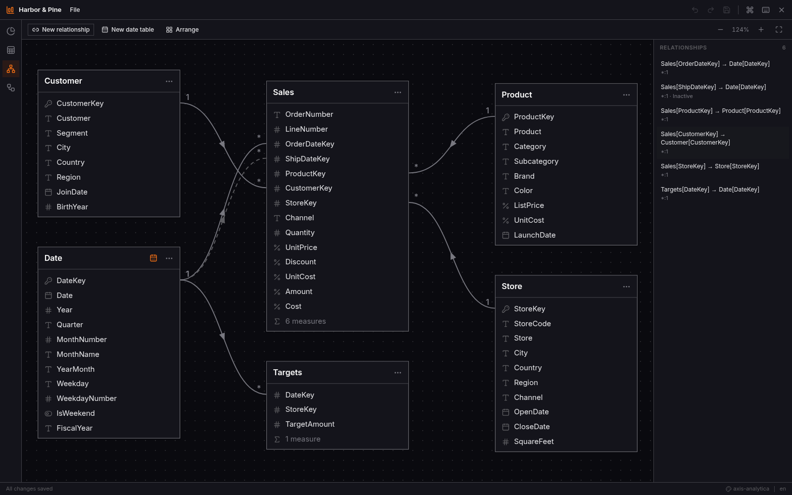
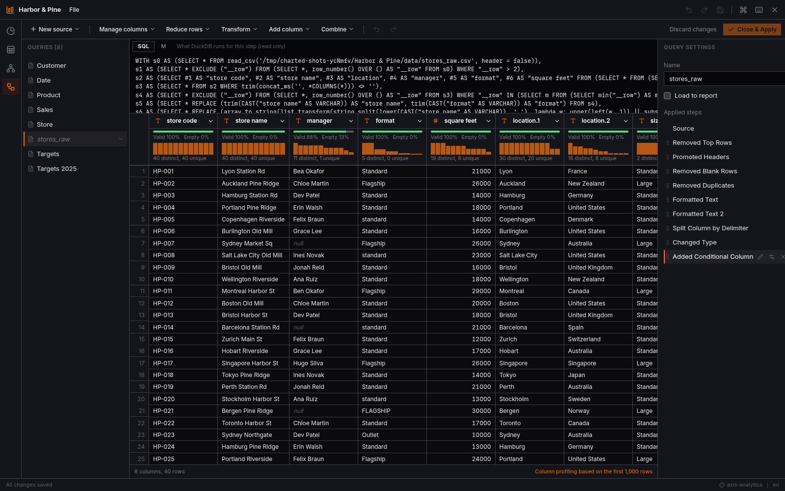
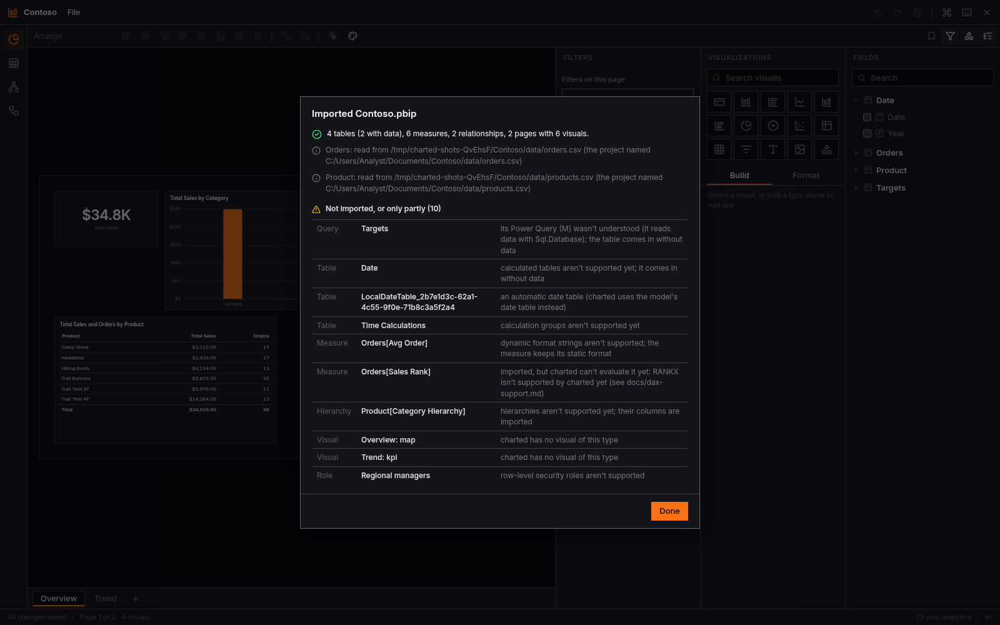
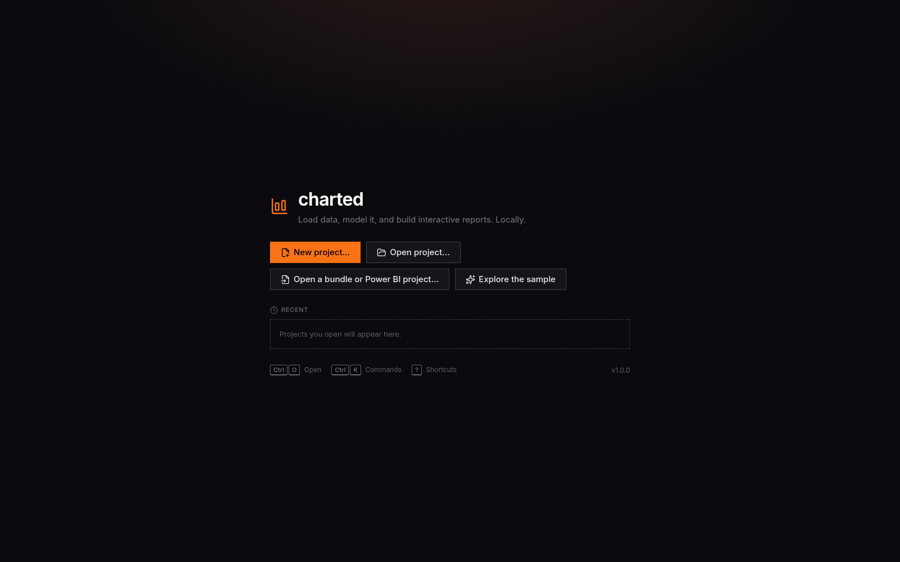

# charted

A lightweight, local-first Power BI Desktop alternative for [Omarchy](https://omarchy.org).

Load data, build a semantic model with relationships and DAX measures, explore it in a
fast data grid, and design interactive reports, all on your own machine. Models are
stored as [Apache Ossie](https://ossie.apache.org/) documents and export to Power BI
projects (PBIP/TMDL/PBIR), so your work is never locked in. Power BI projects import,
with a report of anything that doesn't come across.

> **Status:** v1.5.0. Get and shape data, model it, write DAX (time intelligence,
> calculated tables and columns, calculation groups), build interactive reports with
> drill-down, drill-through, bookmarks and parameters, preview row-level security, and
> move projects to and from Power BI. New in 1.5: an agent inside the app (Claude Code
> or Codex) that builds pages and edits the model as you watch. See [Install](#install) and what comes next in
> [docs/ROADMAP.md](docs/ROADMAP.md).



| | |
|---|---|
|  |  |
| Time intelligence and the DAX formula bar | Searching visuals; right-click a table for new measures, quick measures and columns |
|  |  |
| The model view | Transform data, with applied steps, profiles and M |
|  |  |
| Opening a Power BI project | Start from scratch, a project, or the sample |

## Install

On Omarchy or any Arch-based system (x86_64 or aarch64), install the release build as
a pacman package:

```sh
mkdir -p ~/src/charted-bin && cd ~/src/charted-bin
curl -LO https://raw.githubusercontent.com/Axis-Analytica/charted/v1.5.0/pkgbuild/PKGBUILD-bin
mv PKGBUILD-bin PKGBUILD
makepkg -si
```

Or build it yourself from a checkout (Rust, Node and pnpm needed):

```sh
git clone https://github.com/Axis-Analytica/charted && cd charted
bin/setup          # toolchains and dependencies
bin/install        # builds a release and installs it as a pacman package
```

charted then appears in the launcher (Super+Space) and opens `.charted` projects,
`.chartedz` bundles and Power BI `.pbip` files. The release tarballs and their checksums
are on the [releases page](https://github.com/Axis-Analytica/charted/releases).

## What works today

**The app**
- A native window for Omarchy that follows your theme, corner rounding, animations
  setting and language live (English, Danish and Arabic so far, right-to-left included).
- Projects as plain folders: the model in `model.ossie.yaml`, load queries in `queries/`,
  the report in `report/` (one small JSON file per page and visual, so changes diff
  well in git), data cached in DuckDB. Atomic saves, crash recovery, unlimited undo.
- No telemetry. The network is used only for what you ask for: database connectors
  (downloaded once you agree) and data files you read from the web.

**Getting and shaping data**
- Start a new project (Ctrl+N) and get data into it, or open an existing one.
- A query editor in the spirit of Power Query: applied steps you can select, rename,
  reorder, edit and delete, with each step's SQL and its Power Query M side by side.
- About 25 transforms: remove or keep rows, promote headers, change types, filter,
  replace values, split and merge columns, custom and conditional columns, group by,
  pivot and unpivot, fill down, merge and append queries, and more.
- Column profiles (quality and distribution) over the first 1,000 rows or all of them.
- Sources: CSV, Excel (with a sheet navigator), JSON, Parquet, a folder of files, files
  on the web, and SQLite and PostgreSQL (their connectors are downloaded only after you
  agree; passwords stay in your desktop keyring). charted notices when a source file
  changes.
- Awkward files read right: UTF-16 and Western European (Windows) text, semicolons with
  decimal commas, ragged rows, title lines above the header, and a column whose type
  changes far down a file. Each text file's delimiter, encoding and decimal separator are
  shown and can be changed.

**Data view**
- A virtual grid that scrolls 10 million rows at 60 fps: sort, filter, find, copy.
- Column properties (type, format string, summarisation, sort-by column, data category)
  and column statistics.
- Calculated columns written in DAX, with `RELATED`.

**Model view**
- The tables laid out as a star, with relationship lines showing cardinality, filter
  direction and inactive relationships.
- Drag one column onto another to relate them; charted counts the keys and suggests the
  cardinality.
- Both-direction filtering, refused (as Power BI does) where it would create two paths.
- Mark a table as a date table, or generate one (years, quarters, months, weekdays, a
  fiscal year) related to your date columns.

**DAX**
- A Monaco editor with autocomplete, parameter hints, hover help, errors as you type and
  a formatter, running in WebAssembly.
- A compiler from DAX to DuckDB SQL covering filter context, `CALCULATE` and its filter
  functions, iterators with context transition, `USERELATIONSHIP`, variables,
  `SWITCH`, text and date functions (`FORMAT`, `SUBSTITUTE`, `DATE`, `EOMONTH`,
  `DATEDIFF`…) and time intelligence (`SAMEPERIODLASTYEAR`, `DATEADD`, `PARALLELPERIOD`,
  `TOTALYTD`/`QTD`/`MTD` with fiscal years, rolling windows with `DATESINPERIOD` and
  `DATESBETWEEN`, `PREVIOUS…`/`NEXT…`). It is checked against an independent reference interpreter with hundreds of
  fixed cases and thousands of random ones. [docs/dax-support.md](docs/dax-support.md)
  lists what is supported.

**Reports**
- A page canvas with snapping, alignment, multiple pages, and report, page and visual
  filters (basic, advanced, top N).
- Search the visual gallery (type "donut", press Enter) and every slicer; a slicer's
  search finds values past the ones it lists, and *Select all* selects what you found.
- Right-click a table or field in the Fields pane: new measure, quick measure or column,
  rename, hide, delete, properties. Quick measures write the DAX for totals, averages
  and counts, per-category values, percentage of total, year-to-date and
  year-over-year, ratios and differences.
- Visuals: card, table, matrix (with subtotals), clustered and stacked column and bar,
  line, pie, donut, scatter/bubble, slicer (list, dropdown, range, relative date), text
  box, image and shape.
- Cross-filtering and highlighting between visuals, Ctrl-click to add to a selection, and
  per-visual interaction settings (filter, highlight or none).
- Drill down, up and through hierarchies (Year → Quarter → Month), drill-through pages
  that open filtered to the data point you right-clicked, and bookmarks you step through
  with the keyboard.
- Focus mode, show as a table, and export a visual's data to CSV.
- Themes: follow the Omarchy desktop theme live, choose a built-in theme, or import a
  Power BI theme file.

**Interop and scripting**
- Export to a Power BI project: PBIP with the model in TMDL (tables, measures,
  calculated columns, relationships, Power Query partitions) and the report in PBIR
  (pages, visuals, filters, drill-through, themes), checked against Microsoft's schemas.
  Optionally copy the data files into the export and set the folder Power BI reads them
  from (for opening it on Windows).
- Import Power BI projects (TMDL or `model.bim`, PBIR or the older `report.json`): the
  model, the Power Query that reads files (on disk or the web), and the report, with an
  import report of what charted can't use yet. An export imports back unchanged.
  Public Power BI projects are part of the tests (`bin/corpus`).
- `.chartedz` bundles: a whole project in one file to share. Export or import Apache
  Ossie with a diff preview.
- **An agent inside the app.** The Agent pane (Ctrl+I) asks the agent already on your
  desktop (Claude Code or Codex, Omarchy's default) to build or change things: "Build a
  page with sales by month as a line, sales by category as a donut and a region
  slicer." Each change lands live while you watch, and a whole request undoes in one
  step. It works through charted's own tools (pages, visuals, filters, themes,
  bookmarks, measures, columns, tables, relationships, roles, calculation groups,
  parameters, and Power Query drafts you apply). It sees your model's names and the
  totals it checks, and rows only if you let it. It uses your agent's own account; other
  agents open in a terminal with the same tools.
- A command line for scripts and agents, all with `--json`: `charted check`,
  `charted query` (including `--visual`), `charted export pbip|ossie`, `charted import`,
  `charted import-pbip`,
  `charted sample create` and `charted skill install`.
- The "Harbor & Pine Outfitters" sample: a deterministic retail star schema at any scale
  up to 10 million rows (`charted sample create <dir> [--scale 10m]`).

## Development

```sh
bin/setup          # one-time: Rust, pnpm, wasm-bindgen and UI dependencies via mise
bin/dev            # run the app with hot reload
bin/test           # full suite: Rust, DAX differential tests, WebAssembly, TypeScript, i18n, end-to-end
bin/checkpoint m6  # milestone review: screenshots plus a live demo (docs/demos/)
bin/build          # release build; bin/install packages and installs it
```

charted is a Tauri 2 app: a Rust core (DuckDB, the semantic model, the DAX compiler) and
a React UI rendered by WebKitGTK. See `docs/` for the milestone demos, performance notes
and the DAX support list, and `docs/HANDOFF.md` for the architecture.

## Roadmap

| Milestone | Scope | Status |
|---|---|---|
| M0 | Spine: shell, project format, Ossie I/O, sample data, Omarchy integration, CLI | Done |
| M1 | Data view: virtual grid, sort/filter, column properties, statistics | Done |
| M2 | First report: canvas, visuals, measures, filters | Done |
| M3 | Real modeling: relationships, DAX language service and compiler, Power BI export | Done |
| M4 | Interactivity: cross-filter/highlight, slicers, matrix, themes | Done |
| M5 | Query editor: applied steps, transforms, profiling, more sources | Done |
| M6 | Interop and release: time intelligence, drill, bookmarks, PBIP import, packaging | Done |
| v1.x | Modelling and DAX, more visuals, report building, interop depth | [Planned](docs/ROADMAP.md) |
| M7 | An agent inside charted that builds report pages on request | Done ([demo](docs/demos/m7.md)) |

## License

Apache-2.0. See [LICENSE](LICENSE). The sample data is synthetic and released under CC0.
